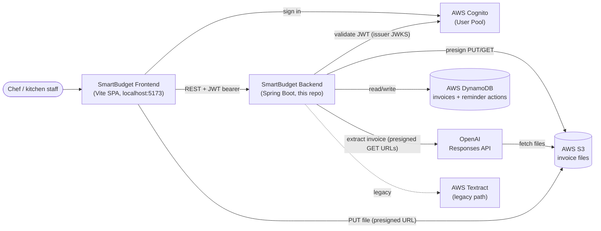
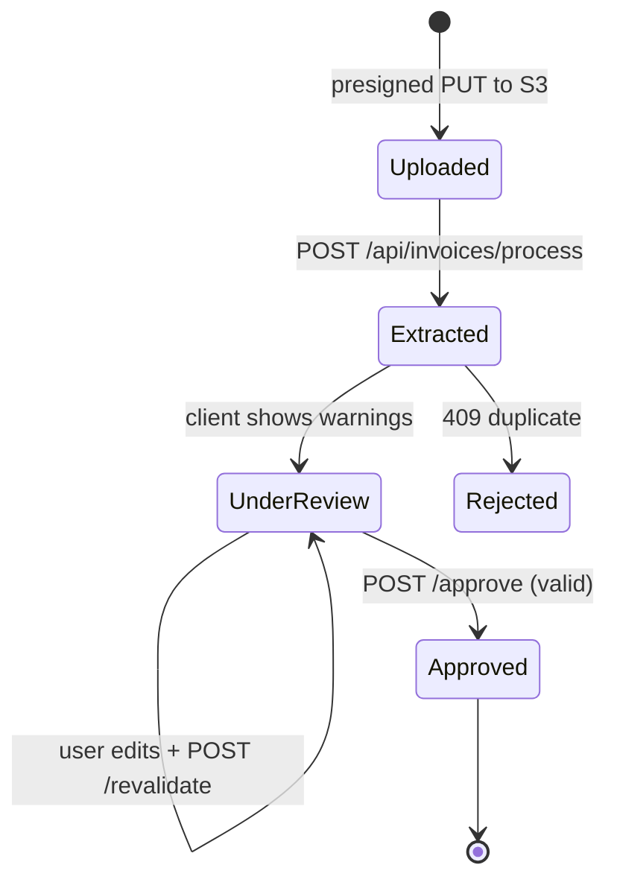
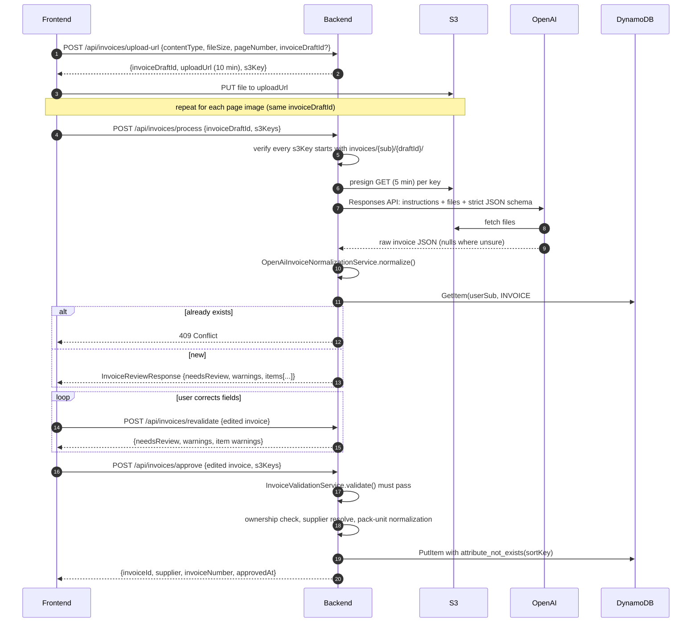
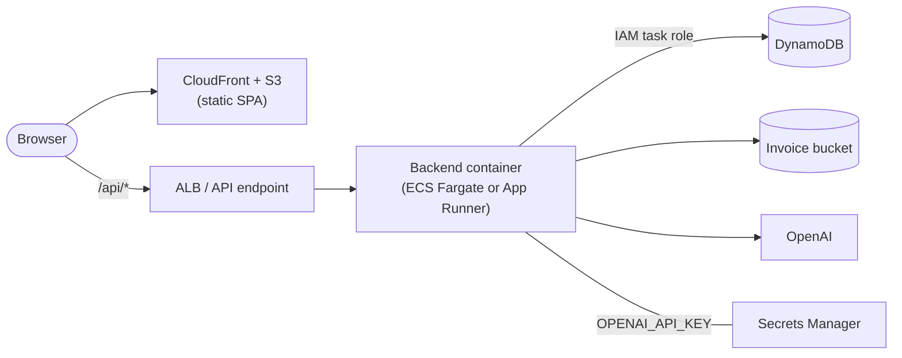

# SmartBudget Backend: System Design

> Audience: developers joining the project.
> Scope: the Spring Boot backend in this repository. The frontend is a separate app, and the system is not deployed yet.

---

## 1. What the system does

SmartBudget helps a commercial kitchen keep control of what it spends on supplies. A chef photographs or uploads supplier invoices. The system reads each invoice with an LLM and checks the numbers with deterministic Java code. A person then reviews and approves the invoice before it is saved. The approved invoices feed four things:

- **A monthly budget dashboard**: ex-GST spend compared with a monthly budget.
- **Invoice and product purchase history.**
- **Price-change insights**: alerts when a product's unit price moves by 5% or more between purchases.
- **Stock-check reminders**: predictions of when a regularly bought product is due to be reordered.

The domain is Australian. Invoices carry GST, the business time zone is `Australia/Melbourne`, and the supplier registry lists Victorian food suppliers.

### Core design principle

> **The LLM transcribes. Java decides.**

OpenAI is told to copy what is printed on the invoice and nothing more. It must never guess, calculate or repair a value, and it returns `null` when it is unsure. All arithmetic, reconciliation, supplier identification and unit normalization happen in Java, and every check is deterministic. A human approves every invoice before it is saved. Every rule described below follows from this principle.

---

## 2. Context



| External system | Purpose | Configured by |
|---|---|---|
| AWS Cognito | Issues JWTs. The backend is an OAuth2 resource server. | `COGNITO_ISSUER_URI` |
| AWS S3 | Stores the uploaded invoice files (PDF, JPEG, PNG) | `S3_BUCKET_NAME`, `AWS_REGION` |
| AWS DynamoDB | Stores approved invoices and the actions taken on reminders | `DYNAMODB_INVOICE_TABLE` (default `smartbudget-invoices`), `aws.dynamodb.reminder-action-table-name` |
| OpenAI Responses API | Extracts invoice data into a strict JSON schema | `OPENAI_API_KEY`, `openai.model` |
| AWS Textract | Legacy alternative for extraction (see §11) | `AWS_REGION` |

---

## 3. Technology stack

| Concern | Choice |
|---|---|
| Language / runtime | Java 21 |
| Framework | Spring Boot 4.1 (Web MVC, Security, OAuth2 Resource Server, RestClient) |
| Build | Maven (`mvnw`) |
| AWS SDK | AWS SDK for Java v2 (S3 + presigner, DynamoDB Enhanced Client, Textract) |
| LLM client | `java.net.http.HttpClient` calling `https://api.openai.com/v1/responses` |
| Money | `BigDecimal` everywhere (never `double`) |
| Boilerplate | Lombok (some DTOs); most DTOs are Java `record`s |

---

## 4. Code structure

The project uses the usual Spring layers, all under `com.smartbudget`.

```
config/       AwsConfig (S3Presigner, TextractClient, DynamoDb clients), SecurityConfig (JWT, CORS)
controller/   Thin REST controllers. They extract jwt.getSubject() and do request ownership checks
service/      All business logic (see table below)
repository/   DynamoDB Enhanced Client wrappers
model/        DynamoDB entities (@DynamoDbBean)
dto/          Request/response records
```

### Service map

| Area | Service | Responsibility |
|---|---|---|
| Upload | `InvoiceUploadService` | Validates file type and size, assigns the draft ID, creates presigned S3 PUT URLs |
| | `S3DownloadUrlService` | Creates 5-minute presigned S3 GET URLs, which are passed to OpenAI |
| Extraction | `OpenAiInvoiceExtractionService` | Builds the prompt and JSON schema, calls OpenAI, parses the raw result |
| | `InvoiceProcessingService` | Orchestrates extract → normalize → duplicate check |
| Normalization | `OpenAiInvoiceNormalizationService` | Turns raw LLM output into a reviewable invoice. Works out what ambiguous amounts mean, reconciles totals and adds warnings |
| | `SupplierNormalizationService` | Maps raw supplier names to a canonical `supplierId` (exact alias match only) |
| | `PackUnitNormalizationService` | Converts quantity, unit and pack size into a standard quantity and unit (`KG`, `L`, `EA`, `BUNCH`) plus a price per unit |
| Validation | `InvoiceValidationService` | The single source of financial rules, shared by `/revalidate` and `/approve` |
| | `InvoiceRevalidationService` | Re-runs validation after the user edits the invoice |
| Persistence | `InvoiceApprovalService` | Final validation, ownership check, supplier resolution, normalization, conditional save |
| Read side | `InvoiceHistoryService`, `InvoiceDetailsService` | Invoice list and detail |
| | `ProductPurchaseHistoryService` | Purchase timeline for one product |
| | `DashboardService` + `MonthlyBudgetProvider` | Monthly spend compared with budget |
| | `ChefPriceInsightService` | Price-change detection |
| | `StockCheckReminderService`, `StockReminderActionService` | Predicts reorders and records the actions taken on reminders |
| Legacy | `TextractService`, `TableRecoveryService`, `InvoiceRecoveryService`, `InvoiceNormalizationService` | Textract-based extraction |

---

## 5. Invoice lifecycle (primary flow)

An invoice moves through four states. Only the last one is stored in the database.



Drafts live only in the client and in S3. There is **no draft table**. The `invoiceDraftId` (a UUID) groups the S3 files that make up one invoice.

### 5.1 Sequence



### 5.2 Upload rules (`InvoiceUploadService`)

- Allowed types: `application/pdf`, `image/jpeg`, `image/png`. Files must be 10 MB or smaller.
- On the first upload the server creates the `invoiceDraftId`. Later pages must send back the same UUID.
- S3 key layout:
  ```
  invoices/{cognitoSub}/{invoiceDraftId}/document.pdf      (a PDF is always one file)
  invoices/{cognitoSub}/{invoiceDraftId}/page-{1..10}.jpg|png
  ```
- Presigned PUT URLs expire after **10 minutes**. The browser uploads straight to S3, so the backend never streams file bytes.

### 5.3 Extraction (`OpenAiInvoiceExtractionService`)

- Uses the OpenAI **Responses API** with `store: false` and `text.format = json_schema` (`strict: true`). The schema covers the header fields and each line item, and every field accepts `null`.
- Files are passed by URL as presigned S3 GET links (5 min): PDFs as `input_file`, images as `input_image`, both with `detail: high`.
- The prompt sets transcription rules: no guessing, no calculating, no "fixing" product codes, use shipped quantity rather than ordered, which document reference counts as the invoice number, and which date counts as the invoice date. Generic `Amount`/`Total` columns go into `amount` rather than `lineExGst` or `lineTotal`. Java works out what they mean later.
- The call is synchronous. Connect timeout is 20 s and request timeout is 120 s.

### 5.4 Normalization (`OpenAiInvoiceNormalizationService`)

This step turns the raw transcription into an `InvoiceReviewResponse`, with `needsReview` and `warnings` at both invoice and line level. Each recovery rule below is only applied when the arithmetic leaves exactly one possible answer:

- If subtotal and total are both printed and equal, GST is 0.
- If GST is 0 and the total is printed, the subtotal equals the total.
- If every row can be reconstructed and the rows add up to the total, a missing subtotal or GST can be recovered.
- A generic row `amount` is read as `lineExGst` only when the invoice-level figures settle it. Example: Peters prints GST only at invoice level, and its row totals add up exactly to the printed ex-GST subtotal.
- `lineExGst` is **required** on every line because subtotal reconciliation and price analytics depend on it. Line GST and line total are optional, because some suppliers only print GST at invoice level.

### 5.5 Validation (`InvoiceValidationService`)

This is the single source of financial rules, used by both `/revalidate` and `/approve`.

**Header:**
- Supplier is required and must be *recognised* (see §5.6).
- Invoice number is required.
- Invoice date is required and must be `YYYY-MM-DD`.
- Subtotal, GST and total are required and cannot be negative.
- `subtotal + GST = total`, within a tolerance of `0.001`.

**Lines:**
- `quantity × unitPrice ≈ lineExGst`, within a tolerance of `max(0.02, |qty|×0.005 + 0.005)`. This allows for per-unit rounding.
- Line GST and line total are checked when they are present.
- The lines must add up to the header totals.

### 5.6 Supplier identity (`SupplierNormalizationService`)

- Uses an in-code registry: `supplierId → canonical name + aliases`. Current suppliers: `CONAPAK`, `SAJ`, `BIDFOOD`, `PROCAL`, `PETERS`, `UNIVERSITYMEAT`, `MJCHICKENS`.
- To match, the raw name is upper-cased and stripped of everything except `A–Z0–9`, then looked up exactly.
- **There is deliberately no fuzzy matching.** An unrecognised supplier fails validation and needs human confirmation. Supplier identity forms part of the duplicate-detection key, so a wrong guess would either let a duplicate invoice in or block a genuine one.
- To add a supplier, add a `register(...)` call in the constructor.

### 5.7 Pack and unit normalization (`PackUnitNormalizationService`)

Price comparisons need a common base. Each line becomes `normalizedQuantity`, `normalizedUnit` and `normalizedUnitPrice = lineExGst / normalizedQuantity`.

The service tries these steps in order:
1. **Direct measure.** If the unit is already physical, use it. Example: `5.46 KG` → 5.46 KG.
2. **Pack size × quantity.** Supports:
   - multi-pack: `30x115gr`, `6x2L`
   - simple: `2KG`, `500GR`, `15DOZ`, `3BUNCH`
   - trailing descriptive: `1 Box (8kg)`, `1 Pn x 250g`

   If `packSize` can't be parsed, the service tries parsing `unit` as a pack size.
3. **Each.** Unit `EA` with no measurable pack is counted as EA.
4. **Otherwise unresolved** (all fields `null`). The service does not guess.

Target units: `G/GR/GM → KG` (÷1000), `ML → L` (÷1000), `LT/LTR/LITRE… → L`, `DOZ → EA` (×12), `BUNCH(ES) → BUNCH`.

Normalized values are calculated when an invoice is approved and stored on each line item. Read paths (invoice details, insights, reminders) **recalculate them when they are missing**. This covers older invoices saved before a pack format was supported, so nobody has to re-upload them.

### 5.8 Duplicate prevention

The duplicate check runs in two places:

| Where | How | Purpose |
|---|---|---|
| `/process` | `GetItem` on `INVOICE#{supplierId}#{INVOICE_NO}`. Only runs if the supplier is recognised and the invoice number was extracted. | Fail early, before the user spends time reviewing |
| `/approve` | `PutItem` with `attribute_not_exists(sortKey)`. A `ConditionalCheckFailedException` becomes `409`. | The real guarantee, and safe against races |

The invoice number in the key is trimmed and upper-cased.

---

## 6. Data model (DynamoDB)

Both tables use the same pattern: **one partition per user**. The partition key is `userSub`, the Cognito `sub` claim, and the sort key is a typed string. This keeps tenants isolated by construction: every query is scoped to the caller's `sub` taken from the JWT.

> The application does not create these tables. Create them beforehand with partition key `userSub` (String) and sort key `sortKey` (String).

### 6.1 `smartbudget-invoices` → `InvoiceEntity`

| Attribute | Type | Notes |
|---|---|---|
| `userSub` | S (PK) | Cognito subject |
| `sortKey` | S (SK) | `INVOICE#{supplierId}#{INVOICE_NO_UPPER}`, which doubles as the duplicate key |
| `invoiceId` | S | Internal UUID (used by `/api/invoices/{invoiceId}`) |
| `invoiceDraftId` | S | Links back to the S3 prefix |
| `supplierId`, `supplierName`, `rawSupplierName` | S | Canonical ID and name, plus the name as printed |
| `invoiceNumber`, `invoiceDate` | S | Date is `YYYY-MM-DD` |
| `subtotalExGst`, `gst`, `total` | N | |
| `s3Keys` | L<S> | Original files |
| `items` | L<M> | Embedded `InvoiceLineItemEntity` list |
| `approvedAt` | S | ISO-8601 instant |

`InvoiceLineItemEntity` (embedded):
- As printed: `productCode`, `description`, `brand`, `packSize`, `unit`, `quantity`, `unitPrice`, `lineExGst`, `gstValue`, `lineTotal`, `pageNumber`
- Derived: `normalizedQuantity`, `normalizedUnit`, `normalizedUnitPrice`

Line items are embedded in the invoice instead of stored as separate items. An invoice is always read and written as a whole, and this avoids extra writes. The cost is the 400 KB DynamoDB item limit, which is ample for invoices of 10 pages or fewer.

### 6.2 `smartbudget-reminder-actions` → `StockReminderActionEntity`

| Attribute | Notes |
|---|---|
| `userSub` (PK) | |
| `sortKey` (SK) | `REMINDER#{supplierId}#{productCode}#{expectedNextDate}` |
| `supplierId`, `productCode`, `expectedNextDate` | |
| `actionType` | `ORDERED` \| `IGNORED` |
| `actionAt` | ISO-8601 instant |

Actions are stored per **reminder occurrence**, meaning per expected date. Dismissing this week's reminder doesn't silence the next cycle. Writes are plain `PutItem`, so the latest action wins.

### 6.3 Access patterns

| Pattern | Implementation |
|---|---|
| Save invoice (no duplicates) | Conditional `PutItem` |
| Duplicate check | `GetItem(userSub, sortKey)` |
| All invoices for user | `Query(userSub)` |
| Invoice by `invoiceId` | `Query(userSub)` + in-memory filter (see §10) |
| All reminder actions for user | `Query(userSub)` |

All analytics (dashboard, history, insights, reminders) load the user's whole partition and compute in memory. That works at one kitchen's volume (hundreds to low thousands of invoices) and keeps the schema simple. §10 covers how this would need to change at larger scale.

---

## 7. Analytics features

### 7.1 Monthly dashboard: `GET /api/dashboard?month=YYYY-MM`
- Includes invoices whose `invoiceDate` falls in the month. Defaults to the current month.
- `spentExGst = Σ subtotalExGst`. Spend is measured **ex-GST**, because a business claims GST back.
- `remaining = budget − spent` and `usedPercentage` is rounded to 1 decimal place.
- The budget comes from `MonthlyBudgetProvider`. The only implementation today is `ConfiguredMonthlyBudgetProvider`, which returns `smartbudget.monthly-budget` (default `31000.00`) for every month. The interface exists so per-month or per-user budgets can be added later.

### 7.2 Invoice history and details
- `GET /api/invoices/history?month=` returns the user's invoices, newest first. `month` is an optional filter.
- `GET /api/invoices/{invoiceId}` returns the full invoice, recalculating normalization for older line items.

### 7.3 Product purchase history: `GET /api/products/history`
Parameters: `supplierId` (required), plus `productCode` **or** `description`/`brand`/`packSize`.

- **With a product code**, the product is identified by `(supplierId, productCode)`, matched case-insensitively.
- **Without a product code** (some suppliers don't print one), the service builds a fallback key from the description:
  1. Upper-case the description and remove spaces and punctuation, after first unifying litre and kilogram spellings.
  2. Remove the brand if it appears at the start, e.g. `PROCALFULLCREAMMILK2L` → `FULLCREAMMILK2L`.
  3. Remove the pack size if it appears at the end, e.g. → `FULLCREAMMILK`.

  This handles cases where the LLM sometimes merges brand or pack size into the description and sometimes doesn't.
- Display details (description, brand) come from the **most recent** purchase, because suppliers rename products over time.

### 7.4 Price-change insights: `GET /api/insights/price-changes`
- Groups line items by `(supplierId, productCode)`. Items without a product code are skipped.
- Compares the two most recent purchases by `normalizedUnitPrice`. Pairs are only compared when **their normalized units match**, so KG is never compared with EA.
- Changes are reported when `|Δ%| ≥ smartbudget.insights.minimum-price-change-percent` (default 5). Results are sorted by largest absolute change first, then by most recent.

### 7.5 Stock-check reminders: `GET /api/reminders/stock-checks`
The service predicts when a regularly bought product should be reordered:

1. Group by `(supplierId, productCode)` and take the **distinct** purchase dates. Several invoices on the same day count as one date, so they don't create zero-day intervals.
2. Require **at least 3 dates**, which gives at least 2 intervals.
3. `typicalInterval` = median gap in days.
4. Check that purchases really recur. An interval counts as consistent if it is within `max(2 days, 35% × typicalInterval)` of the median. Every interval must be consistent, except that once there are 4 or more intervals, one outlier is allowed (for holidays or a missed invoice).
5. `expectedNextDate = lastPurchase + typicalInterval`. Invoices dated in the future are ignored.
6. Status, based on `daysFromExpectedDate = today − expected`, where today is in `Australia/Melbourne`:

   | daysFromExpectedDate | Status |
   |---|---|
   | > 1 | `OVERDUE` |
   | 0 … 1 | `DUE` |
   | −2 … −1 | `UPCOMING` |
   | < −2 | (hidden) |

7. Reminders that already have an action recorded for that exact `expectedNextDate` are hidden.
8. Results are sorted by status (overdue first), then by how far past the expected date they are.

`POST /api/reminders/stock-checks/action` with `{supplierId, productCode, expectedNextDate, actionType: ORDERED|IGNORED}` records the action.

---

## 8. API reference

All endpoints require `Authorization: Bearer <Cognito JWT>`, except `/api/health`.

| Method | Path | Purpose |
|---|---|---|
| GET | `/api/health` | Liveness check (public) |
| POST | `/api/invoices/upload-url` | Get a presigned S3 PUT URL and a draft ID |
| POST | `/api/invoices/process` | **Primary:** extract, normalize and check for duplicates. Returns the review payload |
| POST | `/api/invoices/revalidate` | Re-validate an edited invoice (no side effects) |
| POST | `/api/invoices/approve` | Final validation and save |
| GET | `/api/invoices/history?month=` | Invoice list |
| GET | `/api/invoices/{invoiceId}` | Invoice detail |
| GET | `/api/dashboard?month=` | Monthly spend compared with budget |
| GET | `/api/products/history?supplierId=&productCode=\|description=&brand=&packSize=` | Product purchase timeline |
| GET | `/api/insights/price-changes` | Price-change insights |
| GET | `/api/reminders/stock-checks` | Active stock-check reminders |
| POST | `/api/reminders/stock-checks/action` | Mark a reminder `ORDERED` / `IGNORED` |
| POST | `/api/invoices/openai/review` | Debug: extract + normalize, **without** the duplicate check |
| POST | `/api/invoices/openai/extract` | Debug: raw OpenAI output |
| * | `/api/invoices/textract/...` | Legacy Textract endpoints (see §11) |

Errors are returned as `ResponseStatusException`:
- `400`: validation failures, with the warnings joined into the message
- `403`: S3 key not owned by the caller
- `409`: duplicate invoice

---

## 9. Security

| Concern | Control |
|---|---|
| Authentication | Stateless OAuth2 resource server. JWTs are validated against the Cognito issuer (`spring.security.oauth2.resourceserver.jwt.issuer-uri`). No sessions, so CSRF protection is disabled. |
| Tenant isolation | Every DynamoDB query uses `jwt.getSubject()` as the partition key. Clients never send a user ID. |
| File ownership | Every endpoint that accepts `s3Keys` checks that each key starts with `invoices/{sub}/{invoiceDraftId}/`. Otherwise it returns 403. This stops a user from getting the backend to read or link another user's files. |
| S3 access | The bucket is never public. Clients only get short-lived presigned URLs: PUT for 10 min, GET for 5 min (the GET links go to OpenAI only). |
| Upload limits | Type allow-list and a 10 MB size cap. These are checked when the URL is issued; the presigned URL pins the `Content-Type`. |
| Secrets | `OPENAI_API_KEY` and the AWS settings come from environment variables. AWS credentials come from the default provider chain (env vars, profile or IAM role). |
| LLM data handling | OpenAI requests use `store: false`. |
| CORS | Allows only `http://localhost:5173` and `Authorization`/`Content-Type` headers. |

---

## 10. Known limitations and future work

| Area | Current state | Suggested direction |
|---|---|---|
| Lookup by `invoiceId` | Loads the user's whole partition and filters in memory | Add a GSI on `(userSub, invoiceId)`, or route by `sortKey` |
| Analytics scale | Every request loads all of the user's invoices | Precompute per-product aggregates on approval, or keep a product-history item per `(supplier, product)` |
| Supplier registry | Hardcoded in Java | Move to a DynamoDB table or config, with an admin UI that lets a chef confirm a new supplier |
| Budget | One global value, the same every month | Per-month or per-user budgets behind the existing `MonthlyBudgetProvider` interface |
| No-code products | Product history supports a fallback key, but insights and reminders skip items without a product code | Reuse the fallback product key in insights and reminders |
| Error mapping | `IllegalArgumentException` (e.g. unsupported upload type) has no `@ControllerAdvice` mapping, so it surfaces as 500 | Add a global exception handler that maps it to 400 |
| OpenAI latency | Synchronous call that can take up to 120 s while holding a request thread | Make it asynchronous (a job ID plus polling, or SQS + a worker) if timeouts become a problem |
| Abandoned uploads | Draft files stay in S3 if the user never approves | S3 lifecycle rule to expire unapproved draft prefixes |
| CORS | Hardcoded to localhost | Make allowed origins configurable for each environment |
| Tests | Unit tests for approval, pack normalization, product history and reminders | Add tests for validation and OpenAI normalization (the most rule-heavy code) |

---

## 11. Legacy: Textract extraction path

Before the OpenAI pipeline, extraction ran through AWS Textract, and those endpoints are still in the code (`/api/invoices/textract/*`):

- **Pass 1:** `StartExpenseAnalysis` / `GetExpenseAnalysis` (AnalyzeExpense) for header fields and line items.
- **Pass 2:** used if pass 1 isn't clean. `StartDocumentAnalysis` with `FeatureType.TABLES`, then `TableRecoveryService` and `InvoiceRecoveryService` rebuild line items from the raw table cells.
- `InvoiceNormalizationService` normalizes the Textract output.

Treat this path as **legacy**. New work should go into the OpenAI pipeline. Textract's table output varied too much between supplier layouts, and recovering it needed a lot of supplier-specific heuristics (`TableRecoveryService` alone is about 1,350 lines). The LLM-transcription approach removes most of that heuristic code and keeps all of the deterministic validation.

---

## 12. Running locally

**Prerequisites:**
- Java 21
- AWS credentials with access to the S3 bucket, both DynamoDB tables and (optionally) Textract
- A Cognito User Pool
- An OpenAI API key

```bash
export COGNITO_ISSUER_URI=https://cognito-idp.<region>.amazonaws.com/<userPoolId>
export AWS_REGION=ap-southeast-2
export S3_BUCKET_NAME=<bucket>
export OPENAI_API_KEY=<key>
# optional
export DYNAMODB_INVOICE_TABLE=smartbudget-invoices
export SMARTBUDGET_MONTHLY_BUDGET=31000.00

./mvnw spring-boot:run      # http://localhost:8080
./mvnw test
```

The S3 bucket needs a CORS rule that allows `PUT` from `http://localhost:5173`, because the browser uploads to it directly.

Other settings in `application.properties`:
- `openai.model`
- `smartbudget.insights.minimum-price-change-percent` (default 5)
- `smartbudget.time-zone` (default `Australia/Melbourne`)
- `aws.dynamodb.reminder-action-table-name`

### Proposed deployment (not yet implemented)



- Run as a single stateless container. Scale it horizontally if needed; there is no in-process state.
- Grant AWS access through an IAM task role (least privilege on the bucket prefix and the two tables) rather than static keys.
- Keep `OPENAI_API_KEY` in Secrets Manager.
- Allow the production frontend origin in both Spring CORS and the S3 bucket's CORS rule.
- Add the S3 lifecycle rule for unapproved drafts (§10).
